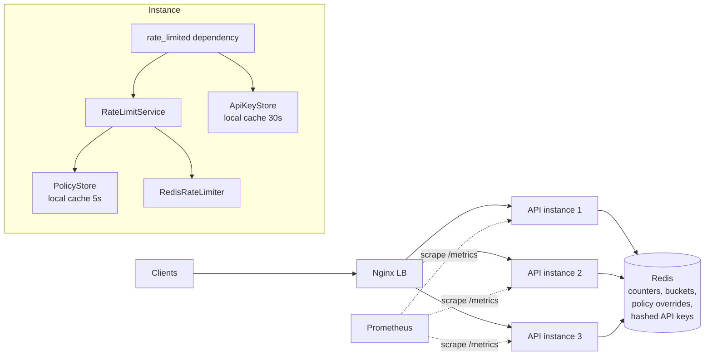
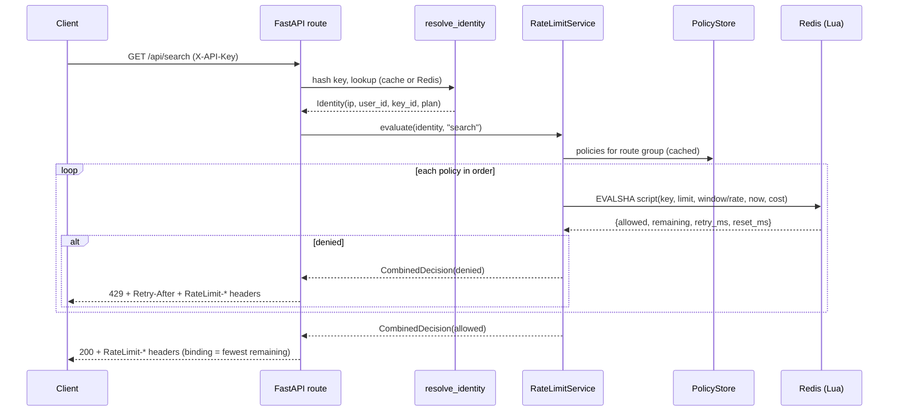
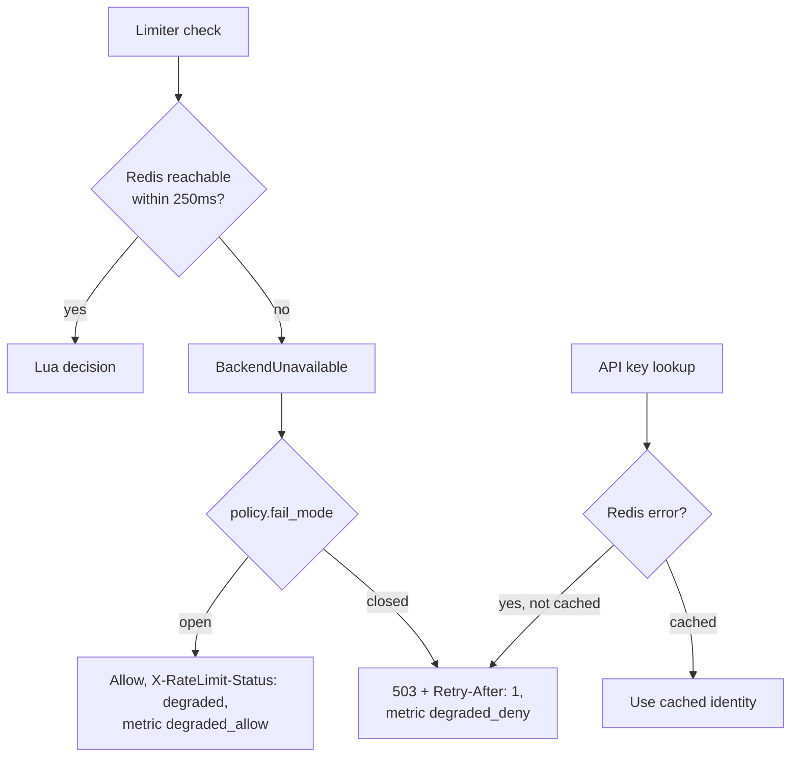

# Architecture -- Distributed Rate Limiter

## Layers

```
ratelimiter/
  main.py                    app factory, wiring (composition root)
  config.py                  env-based settings (RL_*)
  policies.json              default policies + route groups
  api/deps.py                identity resolution, rate_limited() dependency, admin auth
  api/routes.py              demo endpoints + admin endpoints
  services/rate_limit_service.py   orchestration: identity -> policies -> decisions -> headers
  services/policy_store.py   defaults + Redis overrides + local TTL cache
  services/api_keys.py       hashed API keys, cached lookup, fail-closed auth
  services/metrics.py        Prometheus counters/histograms
  domain/models.py           Policy, PlanLimit, Decision, Identity (pure, no I/O)
  limiter/base.py            RateLimiter protocol + BackendUnavailable
  limiter/redis_limiter.py   production backend (Lua scripts)
  limiter/lua/*.lua          one atomic script per algorithm
  limiter/memory_limiter.py  teaching contrast (single-process only)
  limiter/naive_redis_limiter.py  teaching contrast (race condition)
```

Dependency direction: `api -> services -> limiter -> domain`. The domain layer imports nothing
from the others, so policy validation can be unit tested without Redis.

## Component diagram



## Request lifecycle



## Failure and fallback flow



## Key design decisions

1. **Lua scripts, not MULTI/EXEC or WATCH.** A script reads and writes in one atomic step on the
   server, with one network round-trip. WATCH-based optimistic locking needs retries under contention.
2. **Redis server time by default.** `redis.call('TIME')` gives every app instance the same clock,
   so clock skew between servers can't make one instance think a window has ended early. Tests pass
   `now_ms` explicitly for determinism.
3. **Dependency, not global middleware.** `Depends(rate_limited("search"))` lets each route pick a
   policy group and keeps limits visible next to the route.
4. **Policies cached locally, overrides in Redis.** No extra Redis call per request for config;
   changes reach all instances within `RL_POLICY_CACHE_TTL_SECONDS`.
5. **Protocol-based limiter backends.** Redis, in-memory and naive implementations share one
   interface, which is what makes the "why in-memory fails" tests possible.
