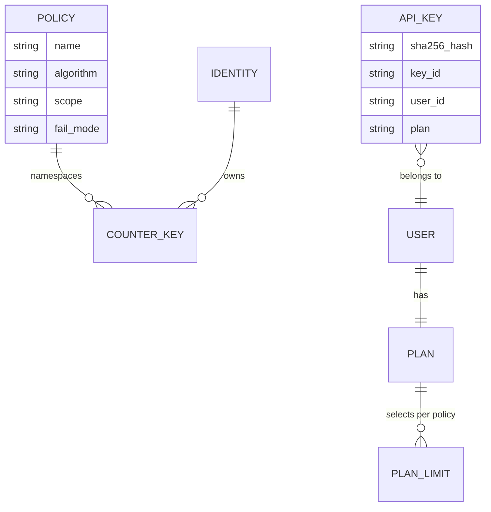

# Data Design -- Distributed Rate Limiter

This project has no SQL database; all state lives in Redis and is **disposable** (losing it resets
counters, which is acceptable for rate limiting). So there are no Alembic migrations here; the
"schema" is the key design below.

## Key layout

| Key | Type | Written by | TTL |
|---|---|---|---|
| `rl:{policy}:{<scope>:<id>}:{window_start_ms}` | string (int) | fixed_window.lua, sliding_counter.lua | window (fixed), 2x window (sliding counter) |
| `rl:{policy}:{<scope>:<id>}` | zset (score = ts ms) | sliding_log.lua | window |
| `rl:{policy}:{<scope>:<id>}` | hash {tokens, ts} | token_bucket.lua | time to refill fully + 1s |
| `rl:{policy}:{<scope>:<id>}` | hash {level, ts} | leaky_bucket.lua | time to drain fully + 1s |
| `rl:config:policies` | hash name -> policy JSON | PolicyStore.upsert | none (config) |
| `rl:apikey:<sha256(raw key)>` | string JSON {key_id, user_id, plan} | ApiKeyStore.create | none |

`<scope>:<id>` examples: `ip:203.0.113.7`, `user:alice`, `api_key:3f9a...`, `anon-ip:203.0.113.7`
(an anonymous caller hitting a user-scoped policy is keyed by IP so "no key" never means "no limit").

## Why `{curly braces}` in keys

Redis Cluster hashes only the part inside `{}` when present. `sliding_counter.lua` touches two keys
(current and previous window); both share the `{identity}` tag, so they land on the same slot and the
script stays legal in Cluster mode (multi-key scripts must not cross slots).

## Relationships

## Memory considerations

- Every key has a TTL, so idle identities clean themselves up; no sweeper job is needed.
- The infra Redis runs without persistence for this project. In production, use a dedicated
  Redis with `maxmemory-policy volatile-ttl` or `allkeys-lru` so memory pressure evicts counters
  rather than rejecting writes (rejected writes would trigger fail-open/closed).
