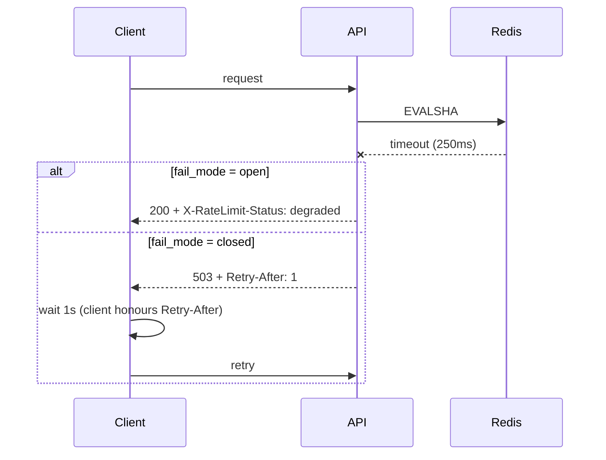

# Failure Scenarios -- Distributed Rate Limiter

| # | Scenario | What happens | Verified by |
|---|---|---|---|
| 1 | Redis down / connection refused | `BackendUnavailable`; fail-open policies allow with `X-RateLimit-Status: degraded`; fail-closed (`login_bruteforce`) returns 503 + `Retry-After: 1` | `tests/test_failure_modes.py`; manual `docker compose stop redis` run |
| 2 | Redis down during API key auth | Uncached keys -> 503 (auth fails closed, never 500, never "allowed as authenticated"); cached keys keep working up to 30s | `test_api_key_auth_fails_closed_with_503_not_500` |
| 3 | Redis restarts (script cache lost) | EVALSHA gets NOSCRIPT, redis-py re-sends the script via EVAL automatically | `test_survives_script_cache_flush` |
| 4 | Redis restarts (counters lost) | Counters reset to zero; clients briefly get a fresh quota. Accepted: rate limit state is soft state | design decision |
| 5 | Connection pool exhausted under a spike | `BlockingConnectionPool` waits up to `RL_REDIS_POOL_TIMEOUT` instead of raising; the default pool raised `MaxConnectionsError`, which would have silently failed open | `test_small_pool_waits_instead_of_failing_open` |
| 6 | Event loop stalled by blocking logging | Redis reads time out although Redis is healthy -> false degraded decisions and 500s. Fixed with QueueHandler logging + 250ms timeout | load test before/after (TESTING.md) |
| 7 | Policy override in Redis is invalid JSON | Ignored with error log; defaults remain | `PolicyStore._refresh` |
| 8 | Redis unreachable when refreshing policies | Last known policies keep being used | `PolicyStore._refresh` |
| 9 | Clock skew between app servers | Irrelevant: scripts use Redis `TIME` | design decision |
| 10 | Client spoofs `X-Real-IP` to dodge per-IP limits | Ignored unless `RL_TRUST_FORWARDED_FOR=true`, which is only set behind our Nginx | `test_untrusted_forwarded_header_is_ignored` |
| 11 | One instance dies behind Nginx | Nginx routes to the others; no state is lost because state is in Redis | manual (`docker compose stop api2`) |

## Retry and fallback flow

## Operational alerts to configure

- `rate(rate_limit_backend_errors_total[1m]) > 0` -> page: protection is degraded.
- `sum(rate(rate_limit_decisions_total{result="denied"}[5m])) / sum(rate(rate_limit_decisions_total[5m])) > 0.3` -> investigate abuse or a too-strict policy.
- `histogram_quantile(0.99, rate(rate_limit_check_seconds_bucket[5m])) > 0.05` -> Redis latency.
