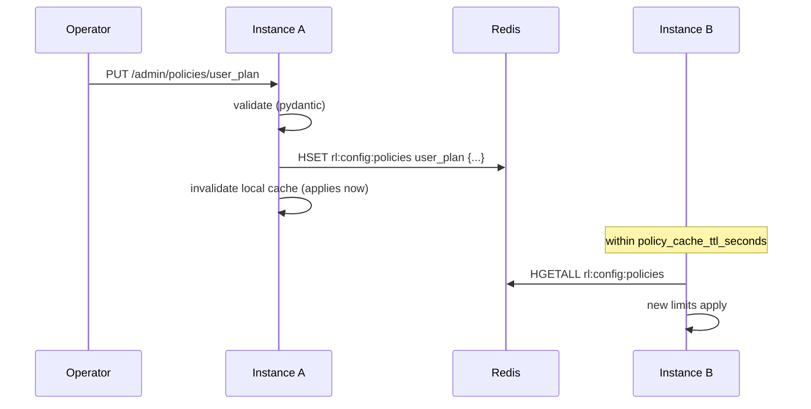

# System Design -- Distributed Rate Limiter

## Requirements

Functional: limit requests per identity (IP, user, API key) using plan-specific quotas; return
standard headers; let operators tune limits at runtime; choose per policy whether to fail open or closed.

Non-functional: correct across N app instances, low added latency (one Redis round-trip per policy),
no single instance holding authoritative state, keeps working (degraded) when Redis is down.

## Capacity reasoning (how to estimate, not measured claims)

- Each policy check = 1 EVALSHA. A route with 2 policies = 2 Redis calls per request.
- A single Redis core typically handles on the order of 10^5 simple ops/s; Lua scripts are heavier
  than GET/SET, and `sliding_log` is O(log N) per ZADD plus cleanup. Measure on your hardware with
  `loadtest/bench_lua.py` before sizing.
- Memory per identity: fixed window ~1 key, sliding counter ~2 keys, token/leaky bucket 1 hash,
  sliding log = up to `limit` ZSET members (the expensive one; use it only for small limits such as login).

## Scaling path

| Scale | What changes |
|---|---|
| 1x (this repo) | Single Redis, 3 app replicas, Nginx |
| 10x | Redis primary + replica with Sentinel failover; `ip_global` moved to the edge (Nginx `limit_req` or CDN) |
| 100x | Redis Cluster sharded by identity (keys already use `{hash tags}`); local pre-check token bucket per instance to absorb obvious abuse before touching Redis; batch/approximate counting for very hot keys |

## Algorithm choice guide

| Algorithm | Memory | Accuracy | Bursts | Use here |
|---|---|---|---|---|
| Fixed window | O(1) | boundary allows 2x burst | yes at boundary | `user_plan` (simple quotas) |
| Sliding log | O(limit) | exact | no | `login_bruteforce` (small limit, must be exact) |
| Sliding counter | O(1) | approximate | smoothed | `ip_global` (huge key space) |
| Token bucket | O(1) | exact for rate | up to capacity | `search_burst` (bursty clients) |
| Leaky bucket | O(1) | exact for rate | up to capacity, smooth drain | `reports_smooth` (protect slow downstream) |

## Event flow (policy change)

