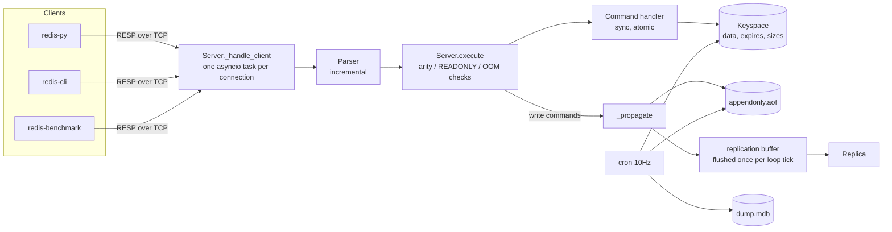
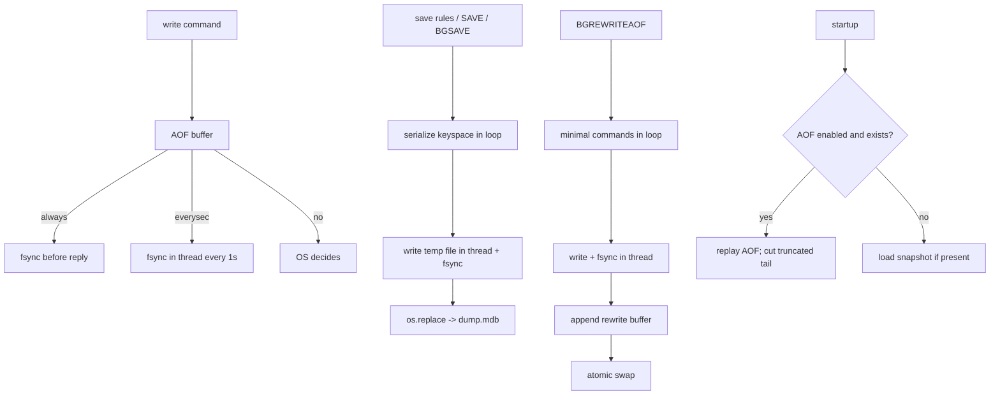

# Architecture -- minidis

```
minidis/
  __main__.py          CLI entry (python -m minidis)
  config.py            ServerConfig + argparse/env parsing
  protocol.py          RESP2/RESP3 incremental parser + encoder
  server.py            TCP server, dispatch, propagation, cron, INFO, BGSAVE/AOF orchestration
  keyspace.py          storage engine: dict + expires + LRU order + memory accounting + eviction
  randomset.py         O(1) random sampling set (active expiry, sampled eviction)
  commands/            one module per data type; handlers are SYNC functions (atomicity)
  persistence/snapshot.py   binary snapshot with CRC32, atomic rename
  persistence/aof.py        append-only file, fsync policies, replay, rewrite
  replication.py       replica-side link (SYNC, stream apply, ACK, reconnect with backoff)
```

## Component diagram



## Request lifecycle (one pipelined batch)

```mermaid
sequenceDiagram
  participant C as Client
  participant L as Connection task
  participant E as execute()
  participant K as Keyspace
  participant A as AOF
  participant R as Replicas
  C->>L: bytes (may hold 1..N commands, or half of one)
  L->>L: parser.feed(); loop get_command()
  loop each complete command
    L->>E: execute(args)
    E->>K: handler mutates state (no await = atomic)
    E->>A: append(encoded command) [write cmds]
    E->>R: queue for batched send [write cmds]
  end
  alt appendfsync = always
    L->>A: fsync (group commit for the whole batch)
  else
    L->>A: flush to OS
  end
  L-->>C: all replies in one write
```

## Why single-threaded is fast enough (and correct)

- The event loop runs one handler at a time and handlers never `await`, so no locks are needed and
  every command is atomic -- the same reason Redis is single-threaded for command execution.
- I/O waiting (sockets, fsync in `everysec`, snapshot writes) happens off the critical path.
- The cost: one slow command blocks everyone (`test_slow_command_blocks_all_clients` demonstrates it).

## Persistence flow


