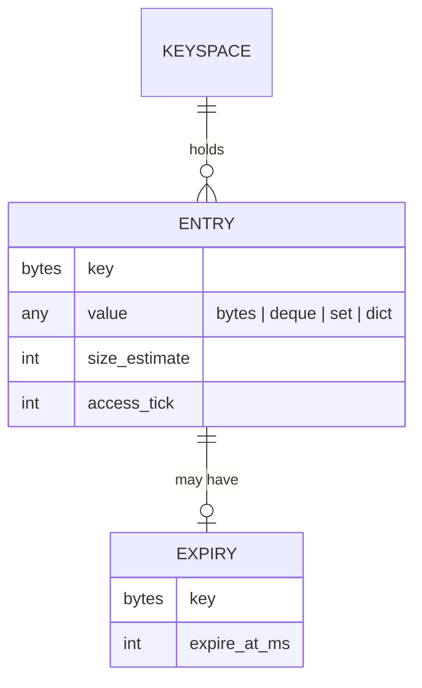

# Storage Design -- minidis

## In-memory structures (`keyspace.py`)

| Structure | Type | Purpose |
|---|---|---|
| `data` | `OrderedDict[bytes, value]` | the main hash table; order = recency (LRU) |
| `expires` | `dict[bytes, int]` | absolute expiry in unix ms, only for volatile keys (like Redis' separate expires dict) |
| `_volatile` | `RandomSet[bytes]` | O(1) uniform sampling of volatile keys |
| `sizes` | `dict[bytes, int]` | estimated payload bytes per key |
| `_atime` | `dict[bytes, int]` | logical access clock for sampled LRU |

Value types: `bytes` (string), `deque` (list: O(1) both ends), `set`, `dict` (hash).
Empty collections are deleted immediately (Redis semantics).



## Snapshot file (`dump.mdb`)

```
"MINIDIS\x01"                                   magic + format version
[ type:1 | expire_ms:int64 | klen:u32 key | payload ]*   S/L/T/H records
0xFF                                            end marker
crc32:u32                                       over everything before it
```

- Integers are big-endian (`struct` `>I`, `>q`).
- Expired keys are skipped on write and on load.
- Corruption (bit flip, truncation) -> CRC mismatch -> load refuses (`CorruptSnapshot`).
- Written via temp file + fsync + `os.replace` so a crash never leaves a half file in place.

## AOF file (`appendonly.aof`)

Plain RESP arrays, one per write command, in execution order. Relative TTLs are rewritten to
absolute `PEXPIREAT` before logging, and lazy/active expirations are logged as `DEL`, so replay is
deterministic regardless of when it happens.

Example after `SET k v EX 60`:

```
*3\r\n$3\r\nSET\r\n$1\r\nk\r\n$1\r\nv\r\n
*3\r\n$9\r\nPEXPIREAT\r\n$1\r\nk\r\n$13\r\n1763300000000\r\n
```

There are no SQL migrations in this project: the "schema" is the binary format above, versioned by
the magic bytes (`\x01`). A format change would bump the version and keep a loader for the old one.
