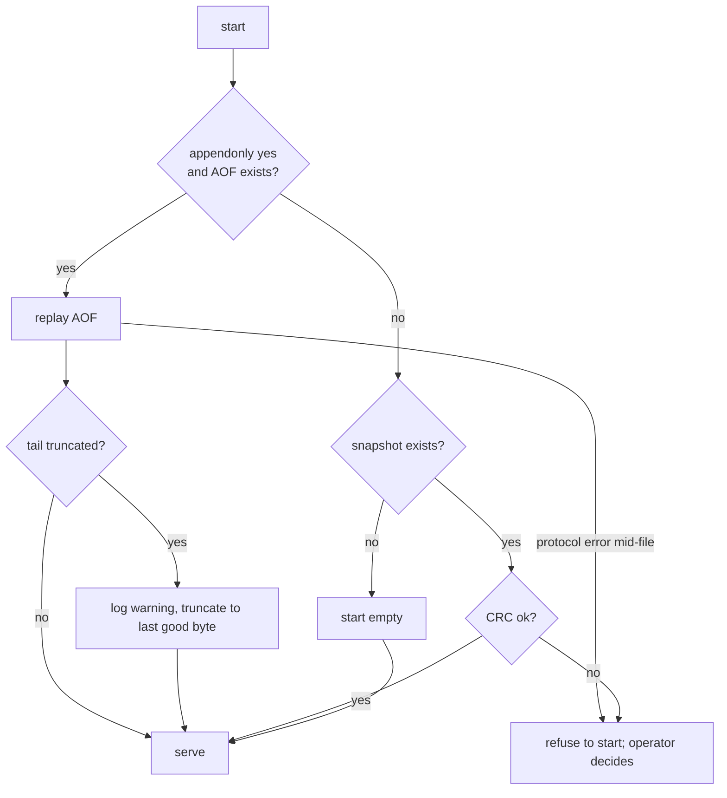

# Failure Scenarios -- minidis

| # | Scenario | Behaviour | Verified by |
|---|---|---|---|
| 1 | Process crash with AOF `always` | Every acknowledged write is on disk (fsync before reply) | `test_aof_restart_without_snapshot[always]` |
| 2 | Crash mid-write leaves half a command at the end of the AOF | Replay applies everything before it, logs `aof_truncated_tail`, truncates the file | `test_aof_truncated_tail_is_recovered` |
| 3 | Garbage in the middle of the AOF | Replay stops with `ProtocolError` (refuses to start with a silently partial dataset) | `AppendOnlyFile.replay` |
| 4 | Snapshot file corrupted or truncated | CRC32 mismatch -> `CorruptSnapshot`, load refused | `test_corrupted_snapshot_is_rejected` |
| 5 | Crash/disk-full while writing a snapshot | Temp file + `os.replace`: old snapshot stays intact | `test_snapshot_atomic_write_keeps_old_file_on_failure` |
| 6 | Writes during BGSAVE | Not in the snapshot; stay counted as dirty for the next save | `test_writes_during_bgsave_stay_dirty` (regression) |
| 7 | Writes during AOF rewrite | Captured in the rewrite buffer, appended before the swap | `test_aof_rewrite_shrinks_and_keeps_concurrent_writes` |
| 8 | Memory limit reached | `noeviction` -> OOM error for writes, reads still work; other policies evict | `test_noeviction_returns_oom_error`, `test_allkeys_lru_server_keeps_hot_key` |
| 9 | Replica starts before master is up / master restarts | Reconnect loop with exponential backoff (0.1s -> 2s), full resync | `test_replica_resyncs_after_master_restart` |
| 10 | Write sent to a replica | `READONLY` error | `test_replica_is_read_only` |
| 11 | Key expires on master | Master propagates `DEL`; replica hides then deletes it | `test_master_expiry_propagates_as_del`, `test_replica_physically_deletes_on_master_del` (regression) |
| 12 | Master dies, need a new master | `REPLICAOF NO ONE` promotes a replica (manual failover) | `test_promote_replica` |
| 13 | Replica too slow to consume the stream | Output buffer > 64MB -> replica disconnected, it full-syncs again | `Server._check_replica_buffers` |
| 14 | Malformed client input | Protocol error reply and the connection is closed (stream can't be resynced) | `test_malformed_input_raises` |
| 15 | Slow command | Blocks all clients (by design) | `test_slow_command_blocks_all_clients` |

## Recovery flow on startup

## Known data-loss windows (be honest in interviews)

- AOF `everysec`: up to ~1s of acknowledged writes.
- Snapshot-only: everything since the last snapshot.
- Async replication + failover: writes acknowledged by the old master but not yet streamed.
