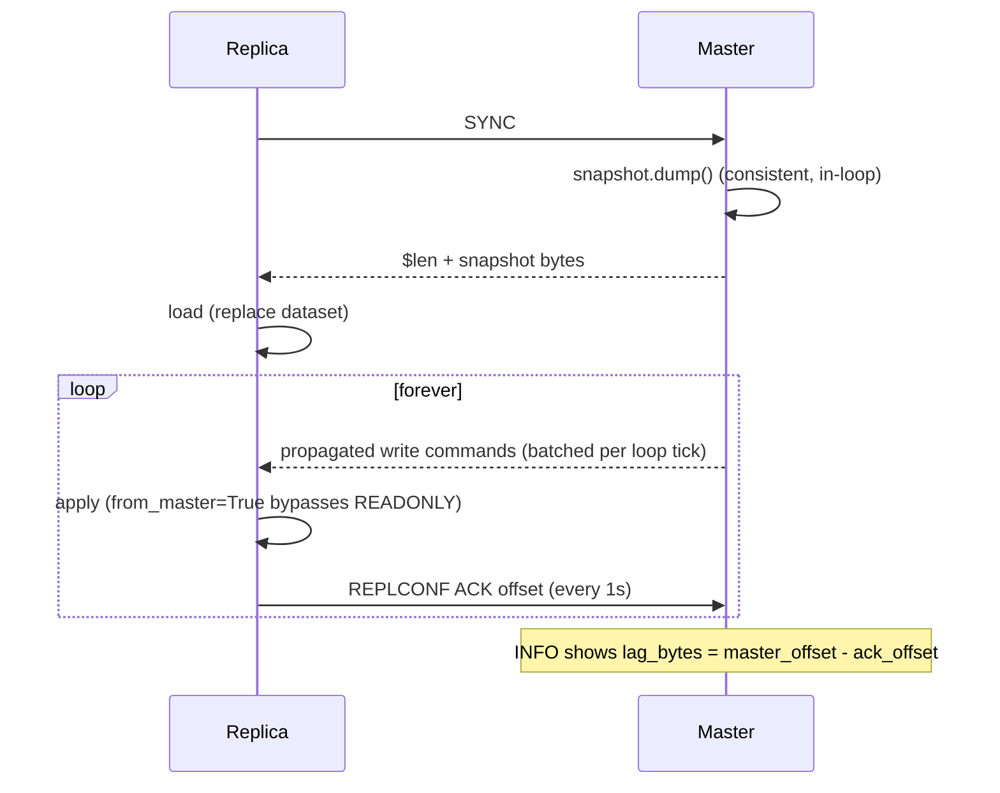

# System Design -- minidis

## Goals

A teaching-grade but real Redis-like server: wire-compatible, single-node correct, durable on
request, replicable. Non-goals: matching Redis performance, clustering, the full command set.

## Key mechanisms

### Expiration (two complementary strategies)

1. **Lazy**: every key access checks `expires[key] <= now` and deletes it. Cheap, but keys nobody
   reads would live forever.
2. **Active**: 10 times a second, sample 20 random volatile keys, delete expired ones, repeat while
   more than 25% were expired (bounded rounds). Probabilistic: memory converges without scanning everything.
   Uniform sampling is O(1) thanks to `RandomSet` (list + index map, swap-remove).

### Eviction (when `maxmemory` is set)

Checked before every write command (as Redis does). Policies: `noeviction` (OOM error),
`allkeys-lru` (exact, OrderedDict order), `volatile-lru` (sample 5 volatile keys, evict oldest
access -- Redis' approximated LRU), `volatile-ttl` (sample, evict soonest expiry).

### Durability spectrum

| Mode | What you can lose on power loss | Cost |
|---|---|---|
| no persistence | everything | none |
| snapshots only | since last snapshot (minutes) | periodic CPU + disk |
| AOF `no` | whatever the OS hadn't flushed (~30s on Linux) | write per batch |
| AOF `everysec` | ~1s | fsync per second in a thread |
| AOF `always` | nothing acknowledged | fsync per client batch (group commit) |

### Replication

- **Asynchronous**: master acknowledges clients before replicas confirm -> acknowledged writes can be
  lost on master failure (same as default Redis; `WAIT` is not implemented).
- **Expiry consistency**: replicas never expire keys themselves; they hide expired keys from reads
  and delete them when the master's `DEL` arrives.
- **Slow replica protection**: if a replica's output buffer exceeds 64MB it is disconnected; it will
  reconnect and full-sync.

## Scaling path (not implemented, how it would go)

| Need | Approach |
|---|---|
| More reads | more replicas (read-only), clients route reads there and accept staleness |
| Failover | a Sentinel-like monitor that promotes a replica (`REPLICAOF NO ONE` exists) and repoints the others |
| Cheaper reconnects | PSYNC with a replication backlog ring buffer + replication id |
| More data / writes than one node | hash-slot sharding (16384 slots) like Redis Cluster |
| CPU | Redis 6-style threaded I/O (parse/write on threads, execute on one) |
