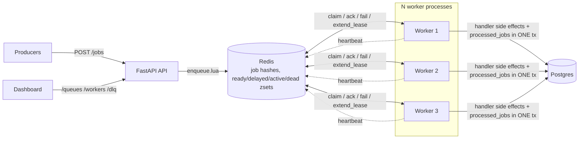
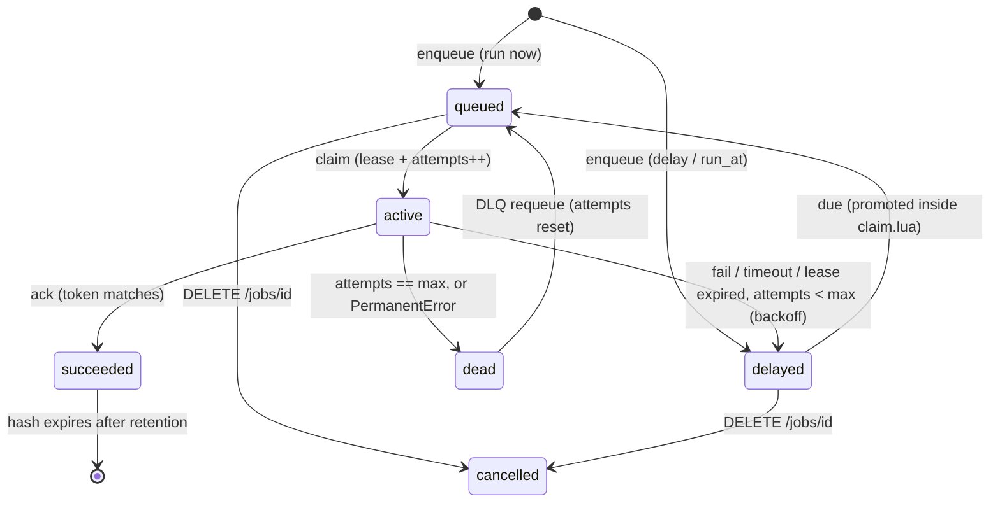

# Architecture -- Distributed Job Queue

```
jobqueue/
  main.py, api/routes.py      producer + management HTTP API, /dashboard
  core/models.py              EnqueueRequest, Job, JobStatus, ScheduleRequest (pydantic)
  core/queue.py               JobQueue: thin client over the Lua scripts
  core/lua/*.lua              enqueue, claim, ack, fail, extend_lease, requeue_dead, cancel, schedule_tick
  core/backoff.py             exponential backoff with full jitter
  worker/worker.py            claim loop, execution, lease keeper, heartbeat, reaper, scheduler, drain
  worker/__main__.py          worker process entry point
  handlers/__init__.py        Registry, JobContext, PermanentError
  handlers/builtin.py         email.send (idempotent), report.generate, demo.* handlers
  db/models.py, session.py    Postgres: processed_jobs ledger, email_outbox
migrations/                   Alembic
```

## Components



## Job state machine



## Lifecycle of one job (with a crash)

```mermaid
sequenceDiagram
  participant API
  participant R as Redis
  participant A as Worker A
  participant B as Worker B
  participant PG as Postgres
  API->>R: enqueue.lua (ready zset)
  A->>R: claim.lua -> attempt=1, lease until T+35s
  A->>PG: BEGIN; insert processed_jobs(job); insert email; COMMIT
  Note over A: process killed before ack
  loop every 2s on every worker
    B->>R: reap_expired: lease < now? fail.lua(reason=lease_expired) -> delayed (backoff)
  end
  B->>R: claim.lua -> attempt=2
  B->>PG: insert processed_jobs -> conflict -> skip side effect
  B->>R: ack.lua(token=2) -> succeeded {duplicate: true}
  Note over A: if A were only paused and woke up: ack.lua(token=1) -> rejected (stale)
```

## Design decisions

1. **One Lua script per transition** -> no partial states (e.g. a job removed from `ready` but never
   added to `active` if the worker dies between two commands).
2. **Attempt number as fencing token** -> monotonic, already stored, no extra key.
3. **Lease capped at 30s + grace, extended every lease/3 while running** -> crash detection time is
   independent of job timeout.
4. **Reaper runs on every worker** -> no single point of failure; `fail.lua` re-checks status +
   deadline atomically so concurrent reapers are harmless.
5. **Batch claim with inline job hash** -> 1 round trip for N jobs (measured 3.6x throughput).
6. **Redis for mechanics, Postgres for business effects** -> queue ops are fast and atomic; the
   correctness-critical side effect + idempotency record get ACID guarantees.
