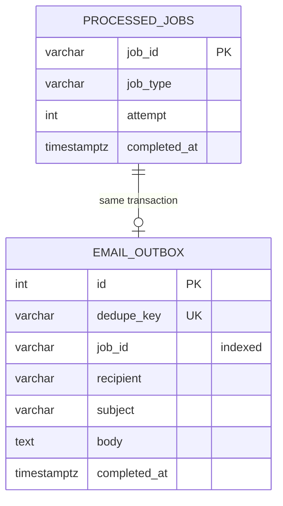

# Data Design -- Distributed Job Queue

## Redis (queue mechanics)

| Key | Type | Content |
|---|---|---|
| `jq:job:{id}` | hash | id, type, queue, payload(json), priority, status, attempts, max_attempts, timeout_ms, backoff_*, created_at, run_at, started_at, finished_at, lease_until, worker, last_error, last_failure_reason, result, idempotency_key |
| `jq:job:{id}:errors` | list | last 20 attempt errors `{attempt, at, reason, error}` |
| `jq:q:{queue}:ready` | zset | score `(9 - priority) * 1e13 + seq` |
| `jq:q:{queue}:delayed` | zset | score `run_at_ms` |
| `jq:q:{queue}:active` | zset | score `lease_until_ms` -> reaper does `ZRANGEBYSCORE -inf now` |
| `jq:q:{queue}:dead` | zset | score `died_at_ms` |
| `jq:q:{queue}:completed` | zset | recent successes, capped at `completed_cap` |
| `jq:q:{queue}:stats` | hash | enqueued, succeeded, retried, reaped, dead, requeued_from_dlq |
| `jq:idem:{key}` | string (TTL) | idempotency key -> job id |
| `jq:schedules` | hash | name -> `{interval_ms, next_run_ms, last_fired_ms, job}` |
| `jq:workers` / `jq:worker:{id}:alive` | hash / string (TTL) | worker info / liveness |
| `jq:seq` | string | FIFO sequence |

Why the score formula works: priorities 0-9 occupy separate bands of 1e13; the sequence (< 1e13)
orders within a band; totals stay below 2^53 so doubles represent them exactly.

Retention: succeeded job hashes `EXPIRE` after `JQ_JOB_RETENTION_SECONDS` (default 24h).

## Postgres (business side, Alembic `migrations/versions/0001_initial.py`)

- `processed_jobs.job_id` primary key = idempotency ledger. `INSERT ... ON CONFLICT DO NOTHING
  RETURNING job_id` returns nothing on the second delivery -> handler skips its effect.
- `email_outbox.dedupe_key` unique = defence in depth against a buggy handler.
- The ledger insert and the effect commit together; that is the whole trick. If they were two
  transactions, a crash between them would either lose the effect or duplicate it.
