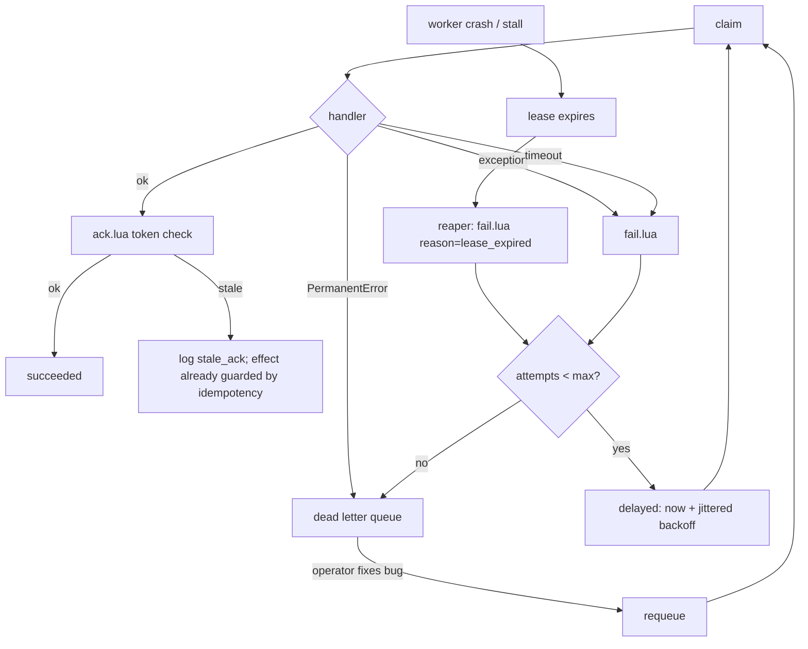

# System Design -- Distributed Job Queue

## Why a background queue

HTTP requests should finish in milliseconds. Sending emails, generating reports, calling slow
third parties, retrying failures -- all of that moves to workers. Benefits: fast responses, retries
without a user waiting, load smoothing (queue absorbs spikes), independent scaling of workers.

## Delivery semantics

| Guarantee | How you get it | Risk |
|---|---|---|
| At-most-once | remove job before processing; never retry | lost jobs when a worker dies |
| **At-least-once (this project)** | lease + redeliver until acked | duplicates -> handlers must be idempotent |
| Exactly-once | impossible end-to-end across a network in general; approximated by at-least-once + idempotent consumer (dedupe ledger in the same transaction as the effect) | |

## Capacity model

Per job: 1 claim (shared by up to N jobs), 1 ack, plus lease extensions for jobs longer than ~11s.
Redis CPU per job is a handful of small O(log n) zset ops. Measured on this dev machine: 577 jobs/s
for 1 worker process, 1,227 jobs/s for 4 (no-op jobs; TESTING.md). Real workloads are bounded by the
handlers (I/O to email providers, databases), so scale workers horizontally.

## Scaling path

| Scale | Change |
|---|---|
| 10x | more worker replicas; separate queues per workload class (critical/default/low) with dedicated worker pools; Redis with AOF + replica |
| 100x | shard queues across Redis instances (queue name -> shard), hash-tag keys per queue for Cluster; push notifications (BZPOPMIN / pub-sub wakeups) instead of polling; move completed-job history to Postgres/ClickHouse |
| Multi-tenant | per-tenant sub-queues + weighted fair claiming; per-tenant concurrency caps (see Project 6) |

## Failure and retry flow

