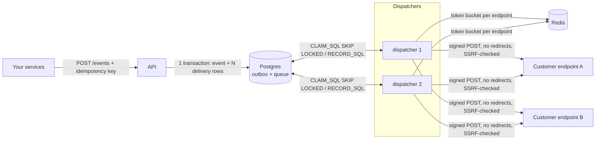
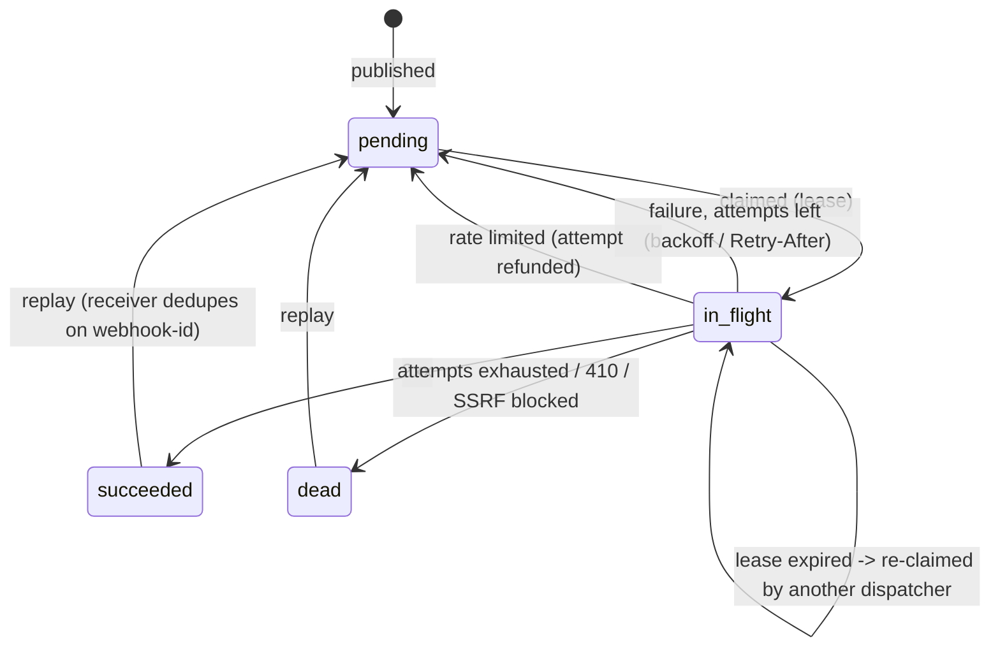

# Architecture -- Webhook Delivery

```
webhooks/
  main.py, api/routes.py        management + publish API, /dashboard
  services/endpoints.py         register / update / rotate secret
  services/events.py            publish = event + fan-out deliveries in one transaction
  services/signing.py           sign + verify (Standard Webhooks)
  services/ssrf.py              destination checks (syntax + DNS resolution at send time)
  services/ratelimit.py         per-endpoint Redis token bucket
  dispatcher/dispatcher.py      CLAIM_SQL (SKIP LOCKED + lease), send, RECORD_SQL (fenced)
  receiver/app.py               reference consumer (verify, dedupe, 2xx fast)
  db/models.py                  endpoints, events, deliveries, delivery_attempts
migrations/                     Alembic
```



## Delivery sequence

```mermaid
sequenceDiagram
  participant API
  participant PG as Postgres
  participant D as Dispatcher
  participant RL as Redis bucket
  participant C as Customer endpoint
  API->>PG: BEGIN; INSERT event; INSERT deliveries (one per subscriber); COMMIT
  D->>PG: CLAIM_SQL: lock due rows SKIP LOCKED, attempts++, lease; return event + endpoint data
  D->>RL: acquire(endpoint)
  alt bucket empty
    D->>PG: back to pending, attempts-- (not the endpoint's fault)
  else
    D->>D: resolve DNS, reject private IPs
    D->>C: POST body + webhook-id/timestamp/signature
    C-->>D: 2xx / 4xx / 5xx / timeout
    D->>PG: RECORD_SQL (one statement): fenced update + attempt log + endpoint health
  end
```

## Delivery states



## Key decisions

1. **Postgres as queue (SKIP LOCKED)** -- the outbox and the queue are the same rows, so publishing is
   one ACID transaction; no Redis/Kafka dual write. (Project 3 shows the Redis alternative.)
2. **Claim returns all send data; record is one statement** -- a delivery costs 2 DB round trips
   (measured 2.3x throughput vs the first version).
3. **`webhook-id` = event id, stable across retries and replays** -- receivers can dedupe.
4. **Dual signatures during rotation** -- receivers never see a gap.
5. **Check SSRF at send time** -- defeats DNS rebinding; registration-time checks are only UX.
