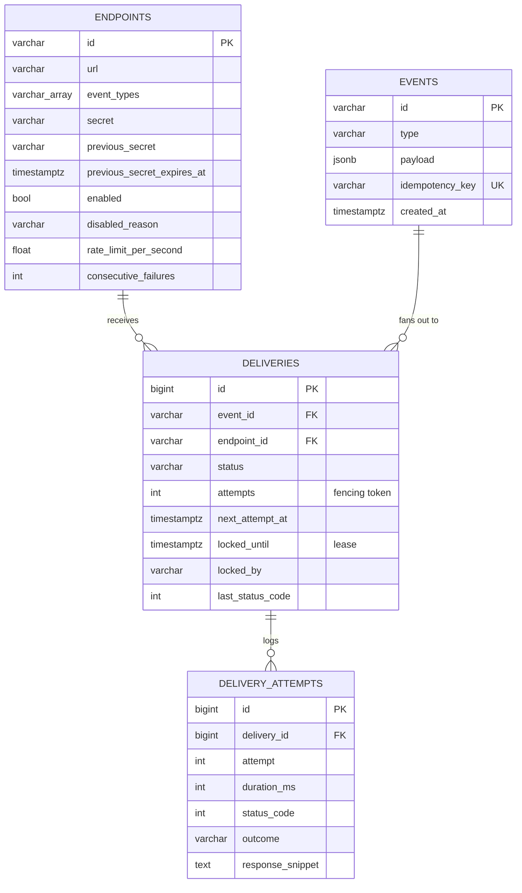

# Database Design -- Webhook Delivery



## Indexes and constraints

| Object | Why |
|---|---|
| `uq_delivery_event_endpoint (event_id, endpoint_id)` | one delivery per pair; replays reuse the row |
| `ix_deliveries_due (next_attempt_at) WHERE status IN ('pending','in_flight')` | partial index: the claim query only scans claimable rows; succeeded/dead history doesn't bloat it |
| `events.idempotency_key UNIQUE` | duplicate publishes return the original event (race-safe via `ON CONFLICT DO NOTHING`) |
| `deliveries.endpoint_id` index | per-endpoint listing / replay-dead |
| FK `ON DELETE CASCADE` | deleting an endpoint removes its deliveries and logs |

## The claim query

```sql
UPDATE deliveries ... SET status='in_flight', attempts=attempts+1, locked_until=now()+lease
WHERE id IN (SELECT ... WHERE (pending AND due) OR (in_flight AND lease expired)
             ORDER BY next_attempt_at LIMIT :batch FOR UPDATE OF d2 SKIP LOCKED)
```

`FOR UPDATE` locks the chosen rows until commit; `SKIP LOCKED` makes concurrent claimers skip them
instead of blocking, so N dispatchers take disjoint batches. The lease + `attempts` fencing make
the rows safe after the lock is released (the HTTP call happens outside the transaction -- never hold
a DB transaction open across a network call to a customer).

Migrations: `migrations/versions/0001_initial.py` (Alembic).
