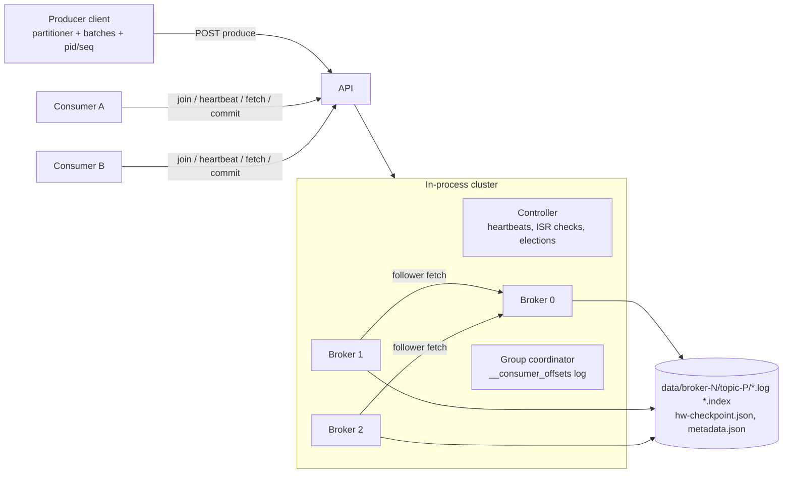
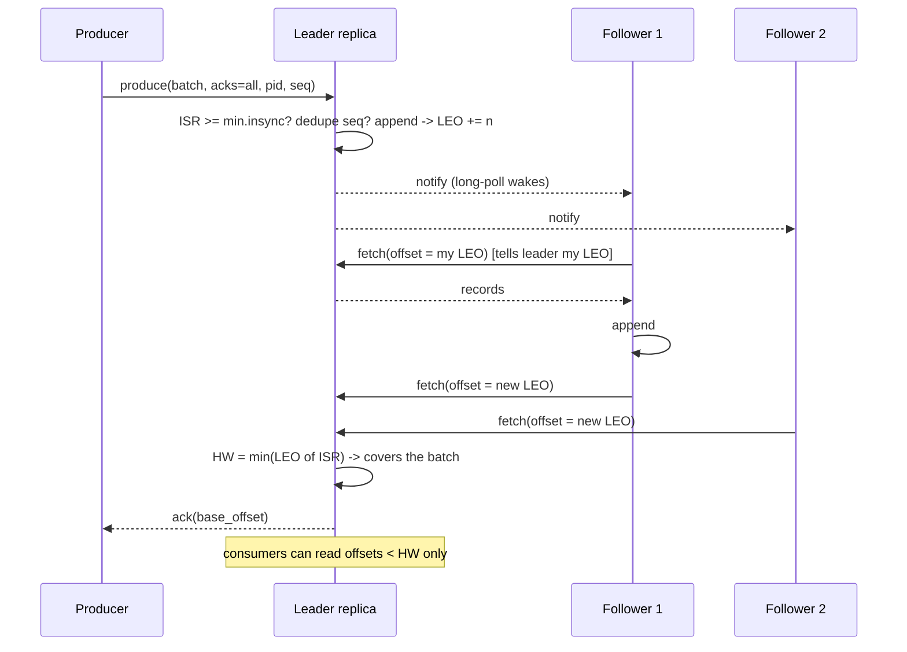
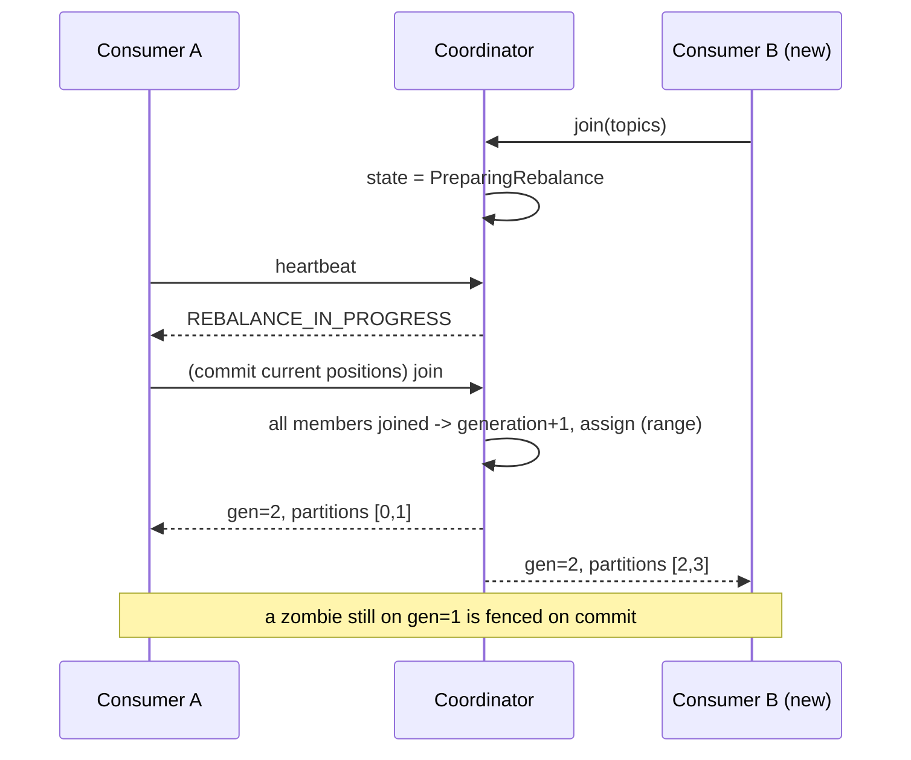

# Architecture -- minikafka

```
minikafka/
  storage/record.py     on-disk record format (size, crc, offset, ts, key, value)
  storage/segment.py    .log + sparse .index, recovery, reusable read handle
  storage/log.py        partition log: segments, LEO, log start, retention, truncation
  cluster/partition.py  Replica (LEO, HW, leader bookkeeping, producer sequence state)
  cluster/cluster.py    brokers, controller loop, replication loops, produce/fetch, election, HW checkpoints
  cluster/groups.py     group coordinator (join/heartbeat/leave/commit, __consumer_offsets log)
  cluster/assignors.py  range, roundrobin
  api/app.py            HTTP API + fault injection + dashboard
  client/producer.py    partitioner, batching, idempotent retries
  client/consumer.py    group membership, poll, commit, seek, heartbeats, rebalance handling
```

## Components



## Produce with acks=all



## Leader failure

```mermaid
sequenceDiagram
  participant B0 as Broker 0 (leader)
  participant CT as Controller
  participant B1 as Broker 1 (ISR)
  B0--xCT: heartbeats stop
  CT->>CT: session timeout -> broker 0 dead
  CT->>B1: become leader (epoch+1), ISR = ISR - {0}
  Note over B1: committed data (< HW) is guaranteed present
  B0->>B0: restart: open logs, recover torn tails, HW from checkpoint
  B0->>B1: fetch as follower; stale epoch -> truncate to HW first
  B1-->>B0: missing records
  CT->>CT: B0 caught up -> back in ISR
```

## Consumer group rebalance


