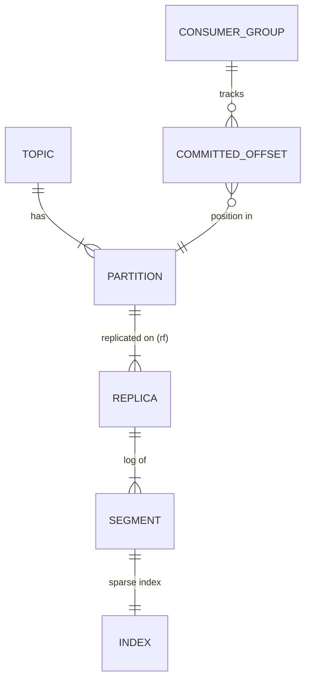

# Storage Design -- minikafka

There is no SQL database: the data model is files.

```
data/
  metadata.json                         controller state: topics, replicas, leader, ISR, epoch
  broker-0/
    hw-checkpoint.json                  {"topic|partition": high_watermark}  (every 100ms)
    orders-0/
      00000000000000000000.log          records with offsets 0 .. N-1
      00000000000000000000.index        sparse (relative offset u32, position u32) every 4KB
      00000000000000004812.log          next segment, base offset = 4812
      00000000000000004812.index
  coordinator/__consumer_offsets-0/     offsets log: key "group|topic|partition", value {"offset": n}
```

## Record frame

`size u32 | crc32 u32 | offset u64 | timestamp i64 | key_len i32 (-1 = null) | key | value_len i32 | value`

- CRC per record detects torn writes and bit rot; recovery stops at the first bad frame and truncates.
- Explicit offsets let a reader verify position and allow followers to copy records verbatim.

## Lookup cost

Find segment: binary search on base offsets (O(log segments)). Find position: binary search in the
sparse index (O(log entries)), then scan at most ~4KB. Reads are sequential afterwards.

## Retention

Whole segments are deleted when their newest record is older than `retention_ms` or the log exceeds
`retention_bytes`; the active segment is never deleted. So data may live up to one segment longer than
configured. Consumers whose position falls below `log_start_offset` get `offset_out_of_range` and
the client resets to the log start.

## Relationships


