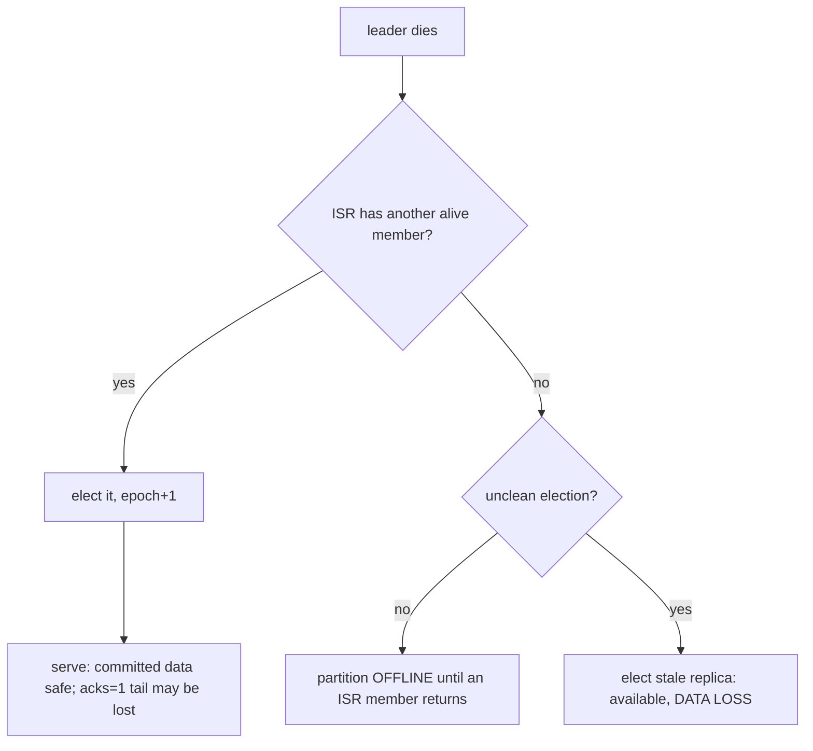

# Failure Scenarios -- minikafka

| # | Scenario | Behaviour | Test |
|---|---|---|---|
| 1 | Leader broker dies | controller detects missed heartbeats, elects a new leader from the ISR (epoch+1); committed data intact | `test_leader_failover_keeps_committed_data` |
| 2 | Leader dies right after acking an acks=1 write | new leader lacks it -> acknowledged message lost; offset reused | `test_acks_1_can_lose_acknowledged_write_on_failover` |
| 3 | Old leader returns with divergent records | restarts with checkpointed HW, truncates, re-fetches | same test |
| 4 | Followers down below min ISR | acks=all refused with `not_enough_replicas` before writing; acks=1 still accepted | `test_min_insync_replicas_rejects_writes` |
| 5 | Follower slow / partitioned | dropped from ISR after `replica_lag_max_ms`; acks=all stops waiting for it; rejoins after catching up | `test_isr_shrinks_on_lag_and_expands_after_heal` |
| 6 | acks=all can't complete in time | `request_timed_out` -- but the data IS on the leader; blind retry = duplicate -> use idempotence | `test_acks_all_times_out_when_follower_stalls_inside_isr` |
| 7 | Every ISR member down | partition OFFLINE (clean election refuses stale replicas) or, with unclean election, back online with data loss | `test_partition_offline_without_isr_and_unclean_election` |
| 8 | Torn write at end of a segment | recovery truncates to the last valid record | `test_recovery_truncates_torn_tail` |
| 9 | Bit rot inside a segment | CRC mismatch; recovery drops the bad record and everything after it | `test_recovery_stops_at_corrupted_record` |
| 10 | Producer retry after a lost response | idempotent dedupe returns the original offsets | `test_idempotent_producer_dedupes_retries` |
| 11 | Producer during leader failover | retriable errors -> retry with backoff -> continues on the new leader | `test_producer_survives_leader_failure` |
| 12 | Consumer crashes before committing | partitions reassigned after session timeout; records since last commit redelivered | `test_at_least_once_redelivery_after_consumer_crash` |
| 13 | Paused (zombie) consumer commits late | fenced by generation / ownership | `test_commit_fencing_and_ownership` |
| 14 | Consumer position deleted by retention | `offset_out_of_range` -> client resets to log start | `Consumer.poll` |
| 16 | Last ISR member dies, later returns | partition offline meanwhile; the returning member is re-elected (clean) and committed data is visible | `test_offline_partition_recovers_when_last_isr_member_returns` |
| 17 | ISR shrinks below min ISR while an acks=all write waits | `not_enough_replicas_after_append` (write not confirmed to the promised durability) | `test_acks_all_fails_if_isr_shrinks_below_min_during_the_write` |
| 15 | Whole cluster restart | metadata.json, logs, HW checkpoints and committed offsets reloaded | `test_metadata_and_logs_survive_full_restart`, `test_committed_offsets_survive_restart` |

