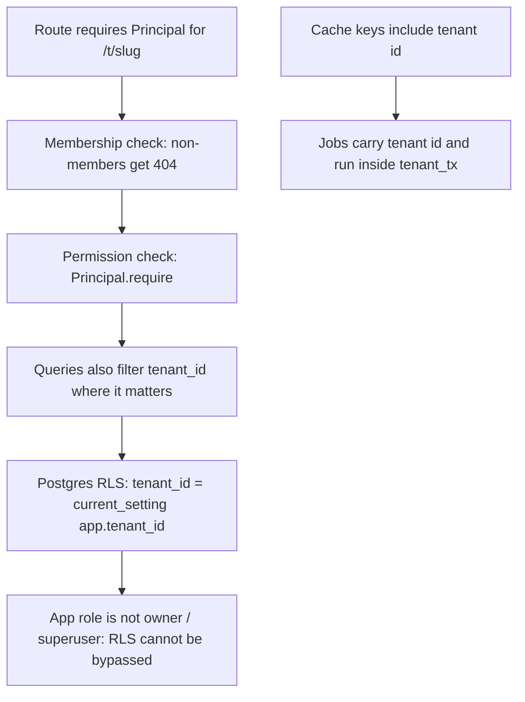

# Architecture -- Multi-Tenant SaaS

```
saas/
  main.py                 app factory (engine, redis, cache, limits, billing provider)
  api/deps.py             auth (JWT | API key) -> tenant -> Principal; suspension, rate limit, metering
  api/routes.py           /auth, /me, /tenants, /t/{slug}/..., /billing, /admin
  core/security.py        bcrypt, JWT, opaque tokens, sha256
  core/rbac.py            permissions, roles, ABAC rule, escalation guard
  core/plans.py           plans, limits, features, rate/quota
  core/principal.py       Principal (tenant, role, permissions, plan)
  db/session.py           tenant_tx(): SET LOCAL app.tenant_id / app.user_id per transaction
  services/tenancy.py     tenants, members, invitations, projects, API keys
  services/auth.py        register/login/refresh rotation/logout
  services/audit.py       audit rows inside the action's transaction
  services/limits.py      tenant token bucket, usage metering/quota, flush to Postgres
  services/cache.py       tenant-namespaced cache
  services/billing.py     BillingProvider protocol, MockBillingProvider, idempotent event application
  services/jobs.py        tenant-aware job queue + handlers
  worker.py               job worker + periodic usage flush
migrations/               0001 schema+RLS+grants, 0002 invitation lookup, 0003 strict memberships policy
```

## Request path

```mermaid
sequenceDiagram
  participant C as Client
  participant D as deps.tenant_principal
  participant R as Redis
  participant PG as Postgres (as saas_app)
  C->>D: GET /t/acme/projects (Bearer JWT or sk_ key)
  D->>R: cache tenant by slug / member role (tenant-namespaced keys)
  alt API key
    D->>PG: resolve_api_key(sha256) [SECURITY DEFINER]
    D->>D: perms = scopes AND creator's current role perms
  else JWT
    D->>PG: role WHERE tenant_id = :t AND user_id = :u (RLS + explicit filter)
  end
  D->>D: suspended? -> 403
  D->>R: tenant token bucket (plan rps) -> 429
  D->>R: INCR usage -> quota_exceeded 429
  D-->>C: Principal
  C->>PG: BEGIN; set_config('app.tenant_id', t, true); query; audit insert; COMMIT
```

## Isolation layers (defence in depth)



## Tenancy model choice

Shared database + shared schema + `tenant_id` column + RLS ("pool" model). Alternatives and when to
switch are in SYSTEM_DESIGN.md.
