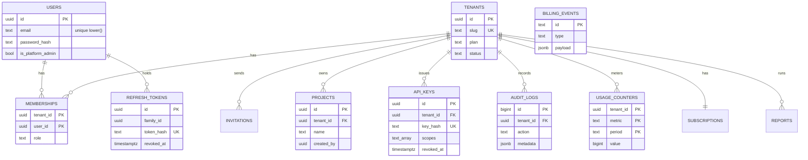

# Database Design -- Multi-Tenant SaaS

## Row-level security

- `ENABLE` + `FORCE ROW LEVEL SECURITY` on every tenant table (FORCE = applies to the owner too).
- Policy: `tenant_id = nullif(current_setting('app.tenant_id', true), '')::uuid` for USING and WITH CHECK.
- Unset context -> NULL -> no rows: fail closed.
- `SET LOCAL` (via `set_config(..., true)`) -> scoped to the transaction -> safe with connection pools.
- App role `saas_app`: `NOSUPERUSER NOBYPASSRLS`, not the table owner. Superusers bypass RLS (test proves it).
- Cross-tenant needs (API key lookup, invitation acceptance, "my workspaces") go through narrow
  `SECURITY DEFINER` functions that take an exact key/hash/user id and return only the needed columns.
- Policies contain no `OR` escape hatches (migration 0003 removed one that caused privilege escalation).

## Grants

App role: SELECT/INSERT/UPDATE/DELETE on data tables; **SELECT/INSERT only on audit_logs** (append-only).

## Indexes

| Index | Purpose |
|---|---|
| `uq_users_email_lower` | case-insensitive unique email |
| `ix_projects_tenant_created (tenant_id, created_at DESC)` | the list query: index scan + LIMIT, no sort (0.148ms vs 2.94ms without, TESTING.md) |
| `ix_audit_tenant_created`, `ix_reports_tenant`, `ix_api_keys_tenant` | tenant-first composite indexes |
| `projects UNIQUE (tenant_id, name)` | names unique per tenant, not globally |
| `ix_memberships_user` | "my workspaces" |
| `api_keys.key_hash UNIQUE`, `refresh_tokens.token_hash UNIQUE` | O(log n) token lookup |

Rule: in a pooled multi-tenant schema, nearly every index should start with `tenant_id`.

Migrations: `0001_initial` (schema, role, RLS, grants, resolve_api_key), `0002_invitation_lookup`,
`0003_strict_memberships_policy`.
