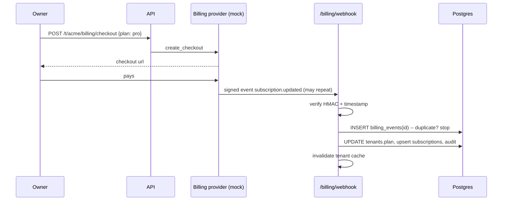

# System Design -- Multi-Tenant SaaS

## Isolation models

| Model | Isolation | Cost / ops | Noisy neighbour | Per-tenant restore | When |
|---|---|---|---|---|---|
| **Shared DB, shared schema, tenant_id + RLS (this repo)** | logical (RLS) | cheapest, one migration | shared resources | hard (row-level export) | most B2B SaaS, many small tenants |
| Schema per tenant | namespace | N schemas to migrate | shared | easier | tens-hundreds of tenants |
| Database per tenant | physical | N databases, pooling pain | isolated | trivial | regulated / very large tenants |
| Hybrid ("silo for enterprise") | mixed | routing layer | per tier | per tier | free/pro pooled, enterprise siloed |

## Request authorization pipeline

authenticate (JWT or API key) -> resolve tenant from URL -> membership (or key tenant) -> role/scopes ->
suspension -> rate limit -> quota -> permission per action -> entitlement per action -> SQL under RLS.

## Plans and enforcement points

| Control | Where enforced | Failure |
|---|---|---|
| requests/second | Redis token bucket per tenant | 429 + Retry-After |
| monthly API calls | Redis counter per tenant per month | 429 `quota_exceeded` |
| max projects / members | count under row lock in the write transaction | 403 `plan_limit_reached` |
| features | `Principal.require_feature` | 403 `feature_not_in_plan` |

## Scaling path

| Scale | Change |
|---|---|
| 10x | PgBouncer in transaction mode (works with SET LOCAL, not with session SET); read replicas for list endpoints; cache hit ratios on hot lookups |
| 100x | partition large tables by tenant_id (hash) or move biggest tenants to silos; Citus-style distribution on tenant_id; usage metering via a stream (Kafka) into an analytics store |
| Noisy neighbours | per-tenant connection/statement timeouts, per-tenant queues, fair scheduling of background jobs |

## Event flow: plan upgrade

