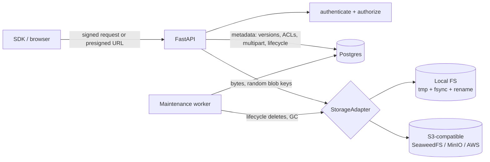

# Architecture -- Object Storage

```
objstore/
  main.py                 app factory; storage backend selection (local | s3)
  api/routes.py           buckets, objects, multipart, presign, admin
  services/signing.py     canonical request, HMAC signing, presigned URLs, key quoting
  services/auth.py        authenticate (header / presigned / anonymous) + authorize (owner, grants, public)
  services/objects.py     put/get/delete/list/versions, multipart, quota, digests
  services/maintenance.py lifecycle, garbage collection, stats
  storage/base.py         StorageAdapter protocol + HashingStream (md5+sha256+size limit while streaming)
  storage/local.py        filesystem adapter
  storage/s3.py           S3-compatible adapter (boto3)
  client.py               signing client (what an SDK does)
  worker.py               periodic lifecycle + GC
migrations/               Alembic (schema, constraints, partial unique index)
```

## Components



## PUT object (write ordering for crash safety)

```mermaid
sequenceDiagram
  participant C as Client
  participant A as API
  participant S as Storage
  participant P as Postgres
  C->>A: PUT /buckets/b/objects/k (stream, Content-MD5, x-obj-content-sha256)
  A->>A: verify signature, authorize write
  A->>S: stream to NEW random blob (md5 + sha256 + size limit on the fly)
  A->>A: compare digests -> 400 BadDigest (blob deleted)
  A->>P: BEGIN; advisory lock(b/k); [bucket lock + quota if quota]; flip versions; INSERT; COMMIT
  A-->>C: 200 ETag, version id
  Note over S,P: crash between blob write and COMMIT = orphan blob, removed by GC after grace period
  Note over P: overwritten / deleted blobs -> blob_deletions queue -> GC deletes asynchronously
```

## GET with Range

```mermaid
sequenceDiagram
  participant C as Client
  participant A as API
  participant P as Postgres
  participant S as Storage
  C->>A: GET (Range: bytes=100-199, If-None-Match)
  A->>P: latest (or versionId) row; delete marker -> 404
  alt ETag matches If-None-Match
    A-->>C: 304
  else
    A->>S: stream bytes 100..199
    A-->>C: 206 Content-Range
  end
```

## Key decisions

1. Metadata/data split: Postgres gives transactions, constraints (one latest per key), and rich queries
   (listing, lifecycle with window functions); blob stores give cheap durable bytes.
2. Blob keys are random and never derived from object keys -> no path traversal, renames are metadata-only.
3. Bytes first, metadata second -> crashes leave garbage (GC'd), never dangling metadata.
4. Deletions are queued, not inline -> request latency and success don't depend on the blob store's delete.
5. Advisory lock per key, bucket lock only with quotas -> writers of different keys run in parallel.
