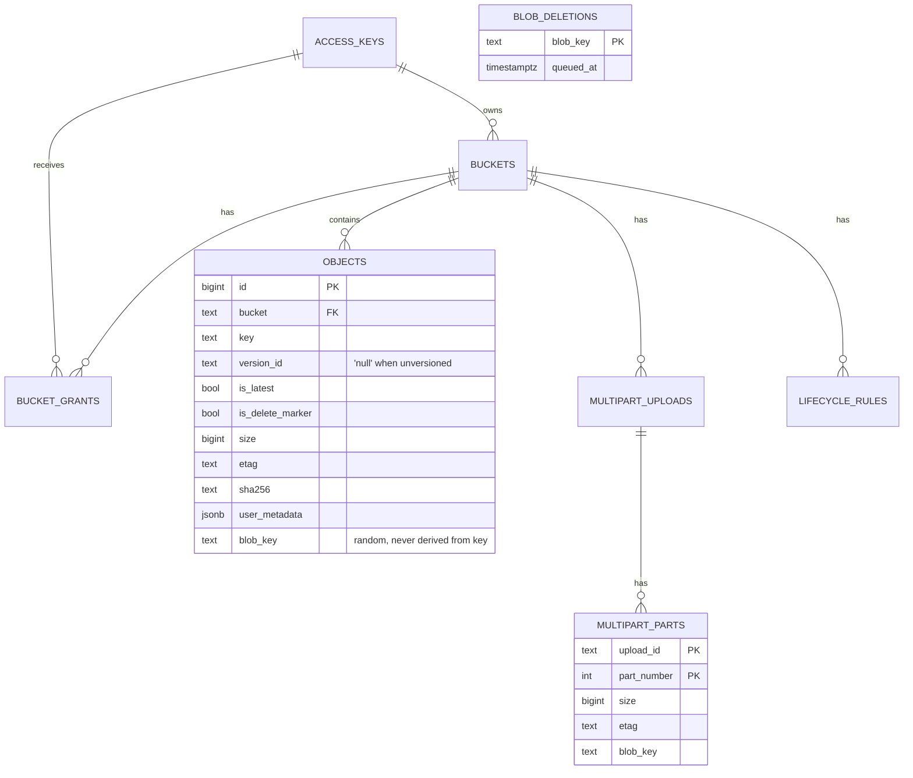

# Database Design -- Object Storage



## Constraints and indexes

| Object | Why |
|---|---|
| `UNIQUE (bucket, key, version_id)` | one row per version |
| `uq_objects_latest (bucket, key) WHERE is_latest` | **at most one latest version per key**, enforced by the DB even under concurrency bugs |
| `ix_objects_list (bucket, key text_pattern_ops) WHERE is_latest AND NOT is_delete_marker` | prefix listing (`LIKE 'docs/%'`) as an index range scan |
| `ix_objects_versions (bucket, key, created_at DESC)` | version listing, promotion after a version delete |
| `ix_objects_blob (blob_key)` | GC reference checks |
| bucket name CHECK | DNS-compatible names (3-63 chars) |
| part_number CHECK 1..10000 | S3 limit |

## Versioning model

- disabled: one row with `version_id = 'null'`, overwritten in place (old blob queued for deletion).
- enabled: every PUT inserts a new row; the previous latest gets `is_latest = false`.
- DELETE without versionId on a versioned bucket inserts a delete marker row (size 0, no blob).
- DELETE with versionId removes that row; if it was latest, the newest remaining row becomes latest.
- suspended: new writes use `'null'` (replacing an earlier null version), existing versions are kept.

## Lifecycle query (noncurrent age)

```sql
SELECT id FROM (
  SELECT id, is_latest,
         lag(created_at) OVER (PARTITION BY key ORDER BY created_at DESC) AS noncurrent_since
  FROM objects WHERE bucket = :b) v
WHERE NOT is_latest AND noncurrent_since < :cutoff
```

A version becomes noncurrent when the next newer version is created, so its age is measured from that
successor's timestamp, not its own.
