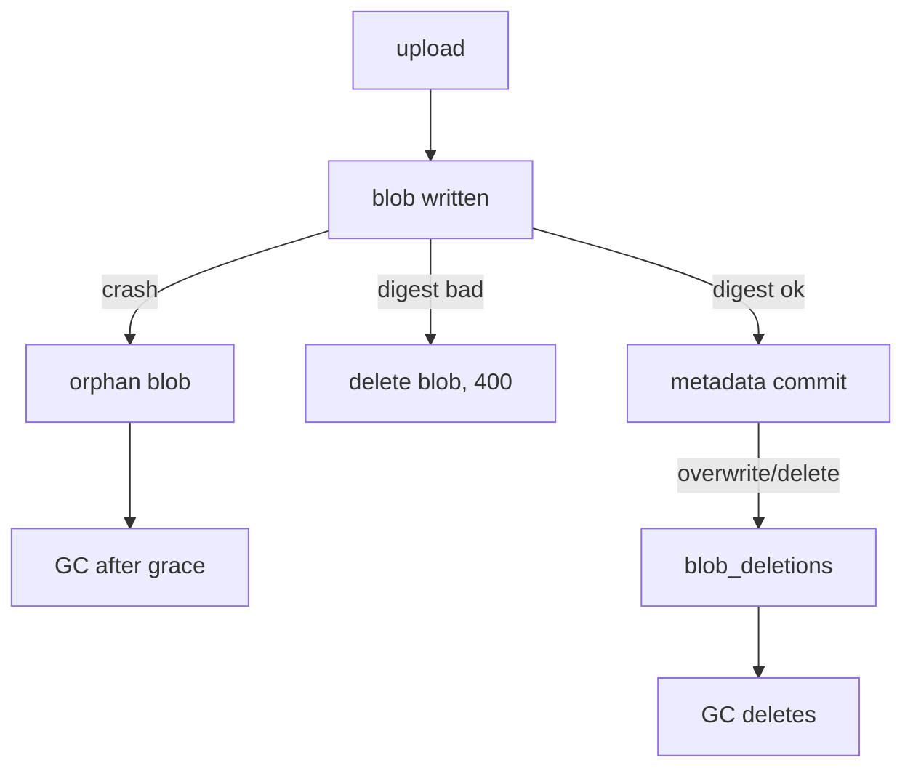

# Failure Scenarios -- Object Storage

| # | Scenario | Behaviour | Test |
|---|---|---|---|
| 1 | Body corrupted in transit | Content-MD5 / SHA-256 mismatch -> 400 BadDigest, blob deleted, no metadata | `test_integrity_checks_reject_corrupted_uploads` |
| 2 | Proxy swaps the body of a signed request | signed payload hash mismatch -> 400 | `test_signed_body_cannot_be_swapped` |
| 3 | Crash after blob write, before metadata commit | orphan blob; GC removes it after the grace period | `test_gc_deletes_queued_and_orphan_blobs_but_keeps_live_ones` |
| 4 | GC runs while an upload is in flight | grace period: young unreferenced blobs are kept | `test_gc_respects_grace_period_for_in_flight_uploads` |
| 5 | Crash while writing a local blob | temp file + atomic rename: no half blob is ever visible; temp files are GC'd | `storage/local.py` |
| 6 | Blob store delete fails / is slow | deletion is queued; request already succeeded | `blob_deletions` |
| 7 | 20 concurrent PUTs to one key | exactly one latest version (partial unique index + advisory lock) | `test_concurrent_writes_to_same_key` |
| 8 | Quota race between concurrent uploads | bucket row lock + check inside the commit transaction | `test_quota_counts_all_versions` |
| 9 | Accidental delete in a versioned bucket | delete marker; remove the marker version to restore | `test_versioning_and_delete_markers` |
| 10 | Multipart part upload fails | re-upload the same part number (replaces it) | `test_multipart_upload` |
| 11 | Client abandons a multipart upload | lifecycle `abort_multipart_days` frees the parts | `test_lifecycle_aborts_stale_multipart` |
| 12 | Leaked presigned URL | bounded by expiry (max 7 days), method and key; revoke the signer's key to kill it early | `test_presigned_urls` |
| 13 | Replayed signed request | rejected outside the 15-min window; inside it, the same request is idempotent for PUT/GET/DELETE | `test_auth_failures` |
| 14 | Malicious keys (`../../etc/passwd`) | stored as data; blob path is random hex; client encodes dot segments | `test_hostile_keys_never_touch_filesystem_paths` |
| 15 | S3 backend unreachable | request fails with 500 before metadata changes (bytes first) | adapter behaviour |

