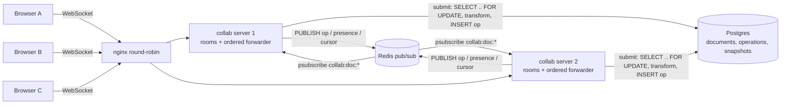
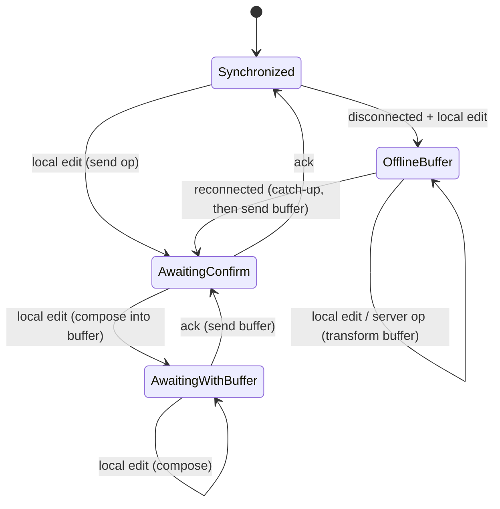
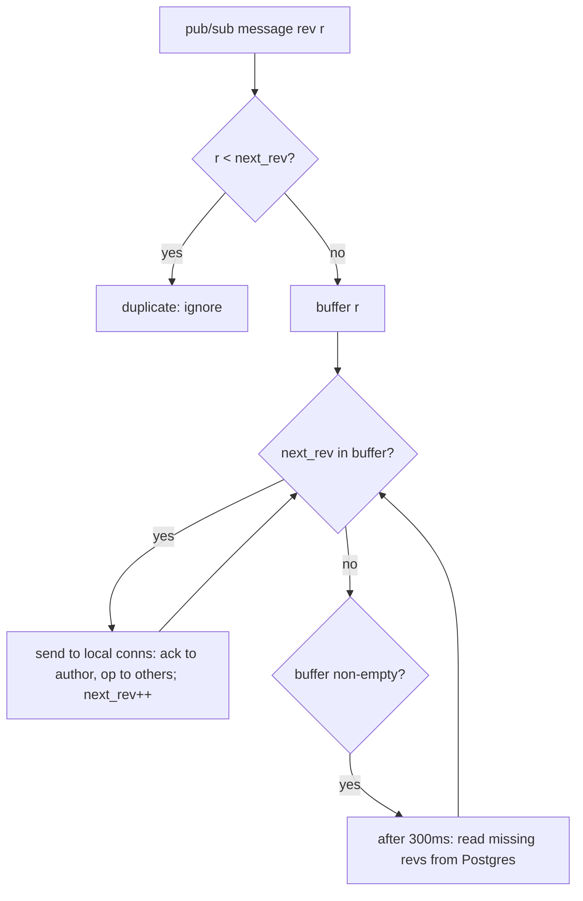

# Architecture -- Collaborative Editing

```
collab/
  ot.py          TextOp (retain/insert/delete), apply, compose, transform, transform_index, diff_op
  service.py     users, documents, permissions, submit() sequencer, history, content_at
  realtime.py    Hub: rooms per server, Redis pub/sub, ordered forwarder + gap fill, presence
  api.py         HTTP (users, tickets, docs, share, history, restore, presence, stats) + /ws
  client.py      reference OT client state machine (Python)
  editor.html    browser demo (same state machine in JS)
migrations/      operations log, snapshots, permissions
```

## Components



## Edit lifecycle

```mermaid
sequenceDiagram
  participant A as Client A (server 1)
  participant S1 as Server 1
  participant PG as Postgres
  participant R as Redis
  participant S2 as Server 2
  participant B as Client B (server 2)
  A->>A: apply locally, outstanding = op (base_rev = 7)
  A->>S1: op {client_seq: 3, base_rev: 7}
  S1->>PG: BEGIN; SELECT doc FOR UPDATE; dedupe(client_id, seq); ops rev > 7
  S1->>S1: transform op against rev 8, then rev 9 (one by one)
  S1->>PG: INSERT op rev 10; UPDATE content; COMMIT
  S1->>R: PUBLISH collab:doc:{id} {rev 10, op', client_id A}
  R-->>S1: message
  R-->>S2: message
  S1-->>A: ack rev 10 (in revision order)
  S2-->>B: op rev 10 -> B transforms its pending ops, applies
```

## Client state machine



## Ordered forwarder (per document, per server)


