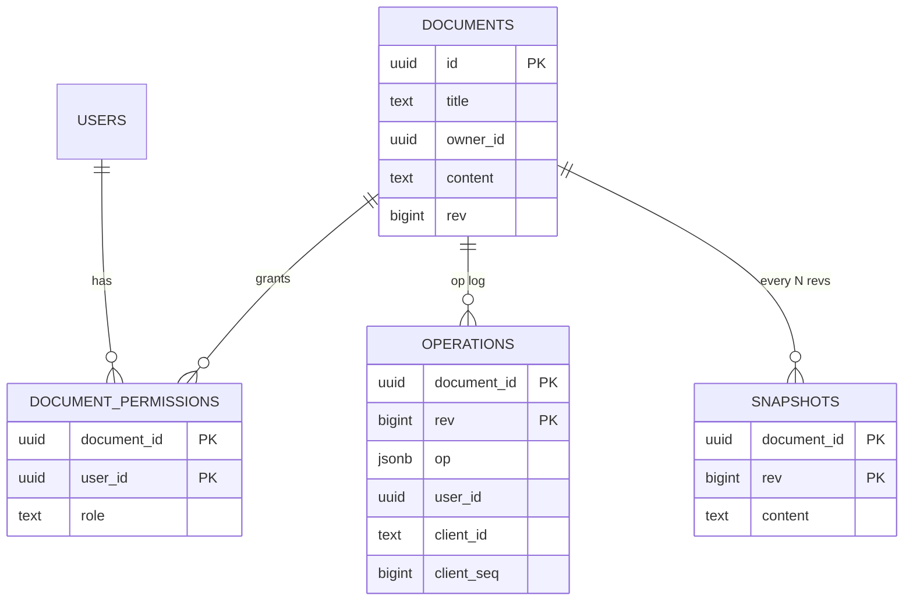

# Database Design -- Collaborative Editing

- `documents.content` + `documents.rev`: current state; the row is the per-document lock.
- `operations (document_id, rev)` PK: the total order. Stored op is the TRANSFORMED op (applies to rev-1),
  so history replay is a plain left fold.
- `UNIQUE (document_id, client_id, client_seq)`: idempotent resend after a lost ack.
- `snapshots`: rev 0 at creation and every `snapshot_every` revs; `content_at(rev)` = nearest snapshot
  <= rev + replay. Bounded reconstruction cost.
- Restore never rewrites history: it appends a new op (diff from current to old content).

Retention / compaction (not implemented, documented): ops older than the newest snapshot could be
archived, at the cost of losing per-edit history beyond it.
