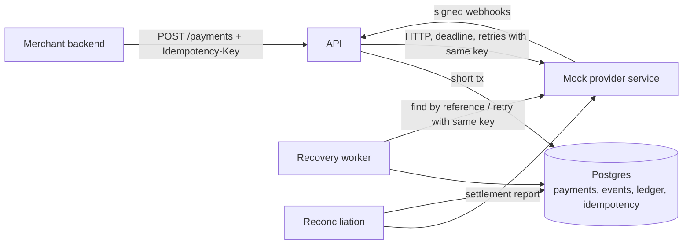
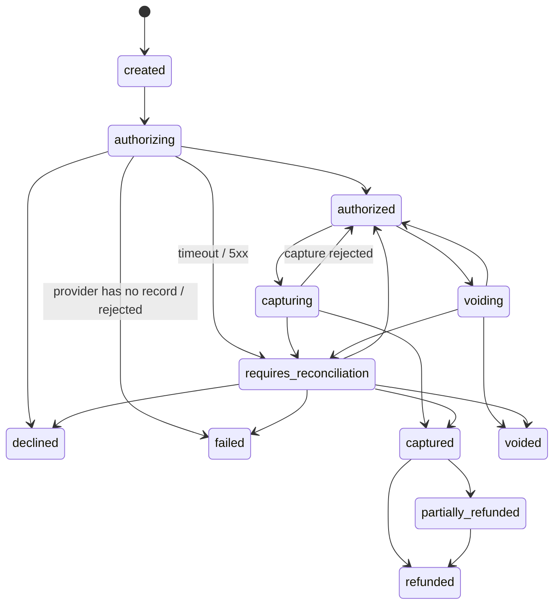

# Architecture -- Payment System

```
payments/
  api/routes.py          merchant API (idempotent POSTs), admin, webhooks, checkout, dashboard
  services/payments.py   create/capture/void/refund flows (intent -> provider -> result)
  services/state.py      transition table + compare-and-set + payment_events
  services/ledger.py     double-entry postings, balances, trial balance
  services/idempotency.py Stripe-style idempotency keys
  services/provider.py   PaymentProvider protocol, HttpProvider (deadline, retries with same key)
  services/webhooks.py   provider webhooks (verify, dedupe, idempotent apply)
  services/recovery.py   resolve stuck/ambiguous payments and refunds
  services/reconcile.py  compare with provider settlement report
  services/saga.py       checkout saga with compensations
  services/money.py      minor units, fee rounding
  worker.py              periodic recovery
mockprovider/app.py      separate service: authorizations, captures, refunds, webhooks, settlements
```

## Components



## Payment state machine



## Capture sequence (crash-safe)

```mermaid
sequenceDiagram
  participant C as Merchant
  participant A as API
  participant DB as Postgres
  participant P as Provider
  C->>A: POST /payments/{id}/capture (Idempotency-Key)
  A->>DB: idempotency key row (in_progress)
  A->>DB: tx: authorized -> capturing (CAS) + event
  A->>P: capture (Idempotency-Key: capture-{id}), deadline 1s, retries
  alt success
    A->>DB: tx: capturing -> captured + ledger posting (same tx)
  else timeout after retries
    A->>DB: capturing -> requires_reconciliation
    Note over A,P: recovery later retries with the SAME key: done once, never twice
  end
  A->>DB: store response under idempotency key
  P-->>A: webhook authorization.captured (dedupe; no-op if already captured)
```
