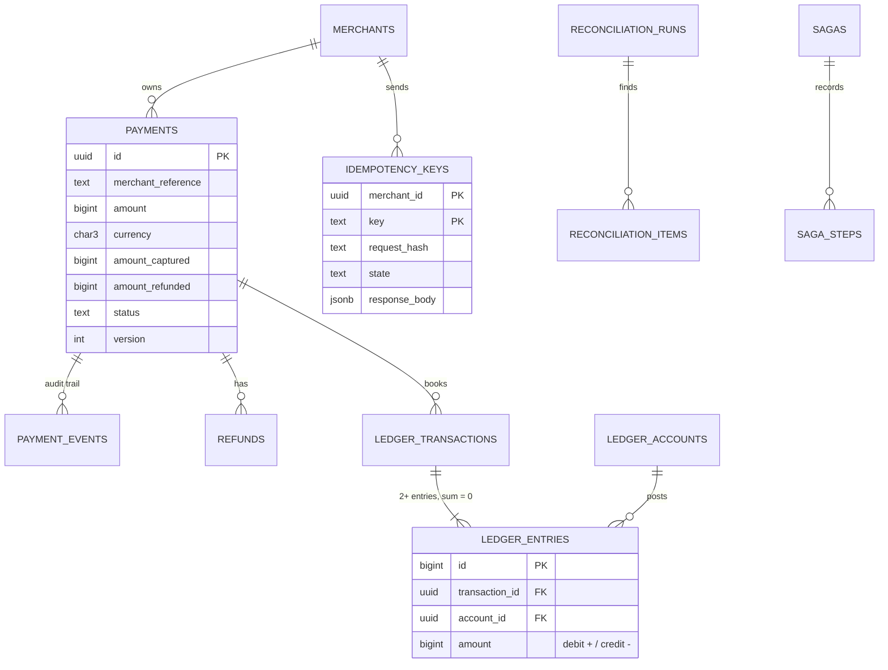

# Database Design -- Payment System

## Invariants and where they live

| Invariant | Enforced by |
|---|---|
| amounts are positive integers (minor units) | CHECK |
| captured <= authorized <= amount; refunded <= captured | CHECK constraints on payments |
| one live payment per (merchant, reference) | partial unique index `WHERE status NOT IN (declined, failed, voided)` |
| every ledger transaction balances | `ledger_balanced` DEFERRABLE INITIALLY DEFERRED constraint trigger (checked at COMMIT) |
| ledger entries never change | `ledger_no_update` trigger (append-only; corrections are reversing transactions) |
| a business event is booked once | `ledger_transactions.idempotency_ref UNIQUE` |
| a provider event is processed once | `provider_events.id` PK |
| a provider payment maps to one payment | unique index on `provider_payment_id` |
| valid status values | CHECK; valid transitions in code (`state.py`) |

## Ledger example (fee 2.9% + 30)

| Event | provider_receivable | merchant_payable | platform_fee_revenue |
|---|---|---|---|
| capture 10,000 (fee 320) | +10,000 | -9,680 | -320 |
| refund 6,000 | -6,000 | +6,000 | |
| **sum of each row** | 0 | 0 | 0 |

Migrations: `migrations/versions/0001_initial.py` (also creates the mock provider's separate `provider` schema).
