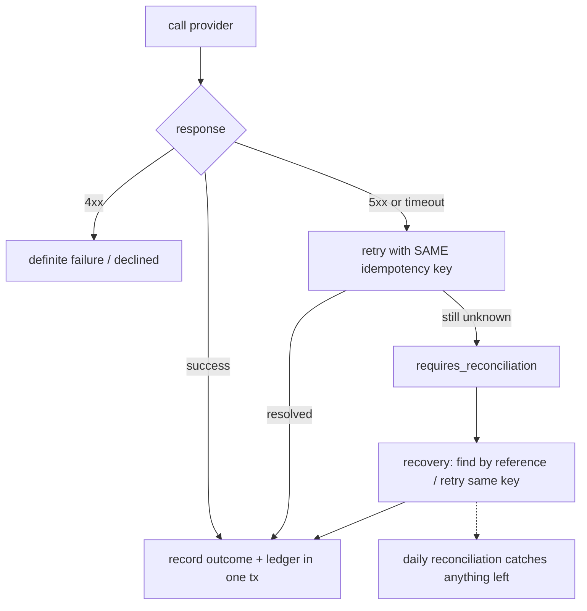

# Failure Scenarios -- Payment System

| # | Scenario | Behaviour | Test |
|---|---|---|---|
| 1 | Client retries POST /payments after a network error | same Idempotency-Key -> stored response replayed, one charge | `test_idempotency_key_semantics` |
| 2 | Same key, different body | 422 `idempotency_key_reused` | same |
| 3 | Concurrent requests with the same key | one runs, others 409 (retry later) | same |
| 4 | Same order paid twice with different keys | 409 `duplicate_payment` (partial unique index) | `test_duplicate_order_payment_blocked` |
| 5 | Provider 500 | retried with the same provider idempotency key -> one authorization | `test_provider_flaky_500_is_retried_safely` |
| 6 | Provider times out but DID authorize | retry with the same key returns the existing authorization | `test_timeout_retried_with_same_key_resolves_immediately` |
| 7 | ... and retries also fail | `requires_reconciliation`; recovery finds it by reference -> authorized | `test_timeout_is_not_treated_as_failure_and_recovery_resolves_it` |
| 8 | Crash after persisting `authorizing`, request never reached provider | recovery: provider has no record -> failed (safe to retry checkout) | `test_payment_unknown_to_provider_is_failed_by_recovery` |
| 9 | Crash mid-capture | recovery retries capture with the same key; ledger booked once even if recovery runs twice | `test_crash_mid_capture_is_completed_by_recovery_exactly_once` |
| 10 | Webhook arrives before our API response | webhook finalises the capture; the late response becomes a no-op | `test_webhooks_are_verified_deduplicated_and_can_finalize_capture` |
| 11 | Duplicate / forged webhook | dedupe by event id / 401 | same |
| 12 | Concurrent captures | one succeeds, others 409 (CAS on status) | `test_concurrent_captures_capture_once` |
| 13 | Concurrent refunds totalling more than captured | row lock + pending refunds counted: exactly 3 of 6 succeed | `test_concurrent_refunds_cannot_over_refund` |
| 14 | Bug tries to book an unbalanced ledger transaction / edit history | rejected by the database | `test_ledger_invariants_enforced_by_database` |
| 15 | Provider-side drift (chargeback/manual adjustment) | reconciliation: amount_mismatch | `test_reconciliation_finds_drift_and_unrecorded_charges` |
| 16 | Charge at provider we never recorded | reconciliation: missing_internally | same |
| 17 | Capture rejected by issuer | payment stays authorized with error recorded | `test_capture_rejected_keeps_payment_authorized` |
| 18 | Shipping fails after payment | saga compensates: refund + release stock | `test_saga_success_and_compensation` |
| 19 | Process dies after creating the payment/refund; client retries with the same key after the lock expires | ids are derived from the Idempotency-Key, so the retry finds the same row and resumes it with the same provider key: one charge, one refund | `test_payment_takeover_after_crash_resumes_the_same_payment`, `test_refund_takeover_after_crash_does_not_refund_twice` |
| 20 | Webhook recorded but applying it failed (crash / DB error) | a redelivery whose earlier outcome is still `received` is applied again (handlers are idempotent CAS) | `test_webhook_whose_first_apply_failed_is_applied_on_redelivery` |
| 21 | Saga's payment outcome unknown (timeout) | saga stops as `failed` / `payment_outcome_unknown`, reservation kept -- never "cancel the order while the money may be taken" | `test_saga_with_unknown_payment_outcome_does_not_cancel_the_order` |
| 22 | Saga's compensating refund fails | saga `failed` (`compensation_incomplete`), step recorded as failed | `test_saga_whose_compensation_fails_is_reported_failed` |
| 23 | Provider rate-limits (429) | treated as retryable (not processed), like 5xx | `provider.py::_call` |

## Bugs found while testing

1. Mock provider's "flaky" marker was written in the same transaction as the 500 it raised -> rolled back ->
   every retry failed. Fixed (own transaction).
2. Reconciliation by local date vs UTC buckets in Postgres matched nothing near midnight IST: settlement days are UTC.

## Review fixes (2026-11-17)

Found by a code review while writing the interview bank; all fixed with regression tests (scenarios 19-23, and the
per-currency ledger trigger + append-only `payment_events` in migration 0002, refund indexes in 0003).

Known, not fixed: reconciliation buckets by `created_at::date` (session time zone dependent; payments near
midnight UTC can land on different days on each side -> false mismatches) and its ledger query has no date
filter; recovery does not use SKIP LOCKED (several workers would pick the same rows -- safe, but duplicate
provider calls); `/checkout` is not behind an Idempotency-Key and `sagas.order_id` is global, not per merchant;
if authorization is ambiguous the `capture=true` intent is not resumed by recovery (it stops at `authorized`).
