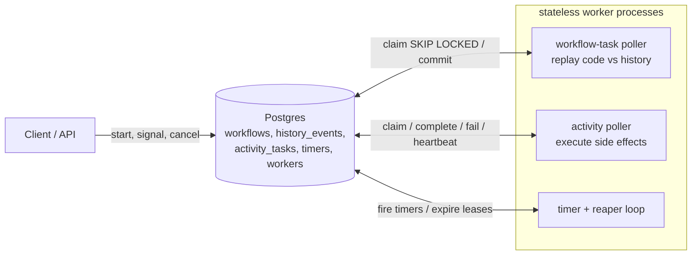
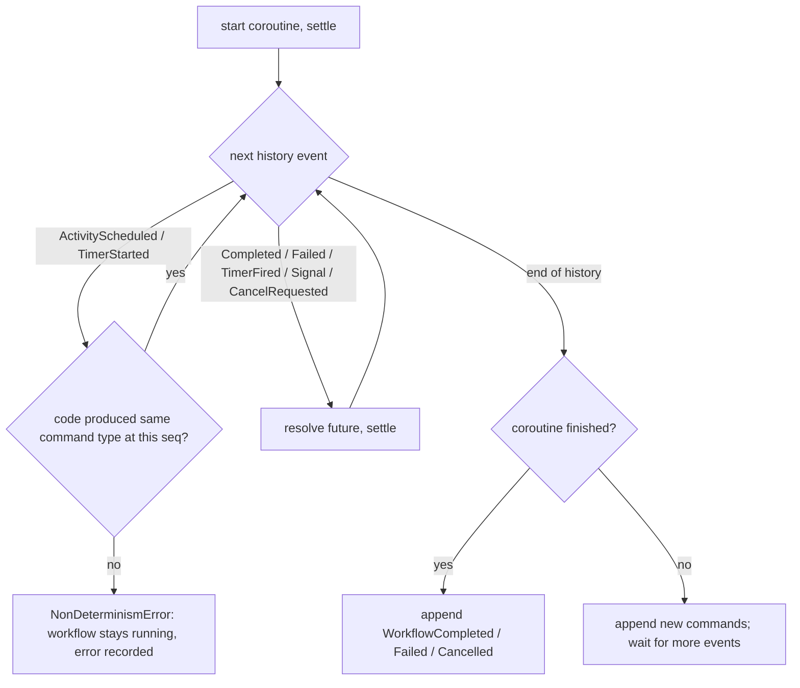

# Architecture -- flowengine

```
flowengine/
  runtime.py      WorkflowContext (activities, timers, signals, deterministic helpers), replay(), RetryPolicy
  store.py        history appends, workflow/activity task claiming, completion, timers, reaper, workers
  worker.py       pollers: workflow tasks (replay), activities (execute), timers + reaper, heartbeat
  activities.py   @activity registry, ActivityContext (idempotency key, heartbeat)
  api.py          start / signal / cancel / describe / history / replay-check / workers / stats
  examples/       five workflows + their activities
```

## Components



## One step of a workflow

```mermaid
sequenceDiagram
  participant API
  participant DB as Postgres
  participant WW as Worker (workflow task)
  participant AW as Worker (activity)
  API->>DB: WorkflowStarted (needs_task = true)
  WW->>DB: claim workflow (lease), read history 1..N
  WW->>WW: replay code; it asks for activity "charge" (seq 2)
  WW->>DB: tx: last_event_id still N? append ActivityScheduled(seq 2), insert activity task
  AW->>DB: claim activity (SKIP LOCKED, lease)
  AW->>AW: run charge_payment (idempotency key wf:2)
  AW->>DB: tx: ActivityCompleted(seq 2, result), needs_task = true
  WW->>DB: claim again, replay 1..N+2: seq 2 now resolved -> code continues
```

## Replay in event order


