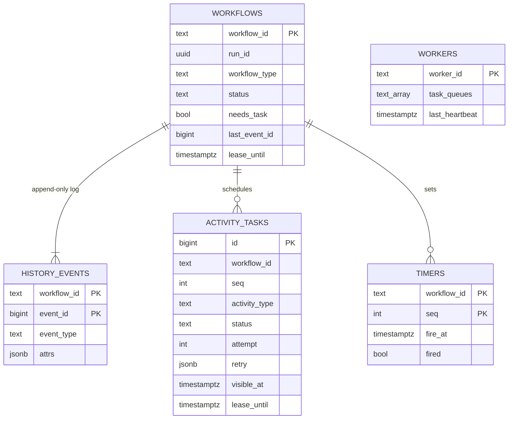

# Database Design -- flowengine

| Design point | Why |
|---|---|
| `history_events (workflow_id, event_id)` PK, gap-free ids assigned under the workflow row lock | total order of facts per workflow; replay is deterministic |
| `workflows.last_event_id` | optimistic check: a workflow-task result is only committed if no event arrived during replay |
| `needs_task` + partial index on running workflows | pollers scan only workflows with work |
| `activity_tasks UNIQUE (workflow_id, seq)` | a command can never be scheduled twice |
| `visible_at` | retry backoff without a scheduler: tasks become claimable later |
| `lease_until` + `attempt` | crash recovery (reaper) and fencing (stale completions rejected) |
| `timers` with partial index on unfired | durable timers survive restarts |
| `activity_effects` (examples) | proves exactly-once side effects via the idempotency key |

Event types: WorkflowStarted, ActivityScheduled, ActivityCompleted, ActivityFailed, TimerStarted, TimerFired,
SignalReceived, CancelRequested, WorkflowCompleted, WorkflowFailed, WorkflowCancelled.
